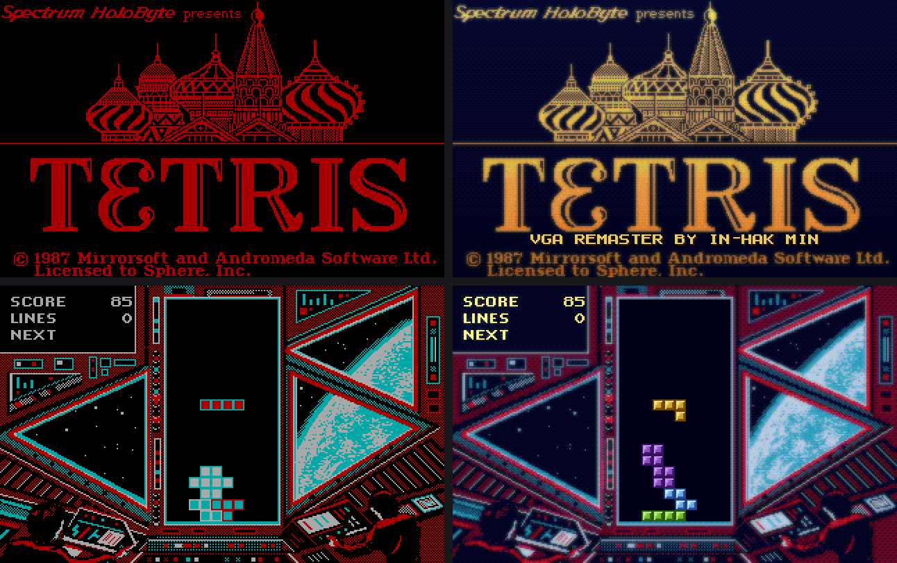
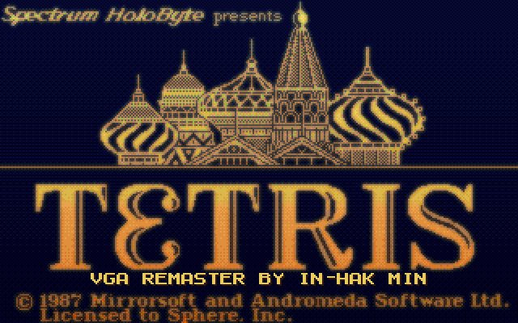
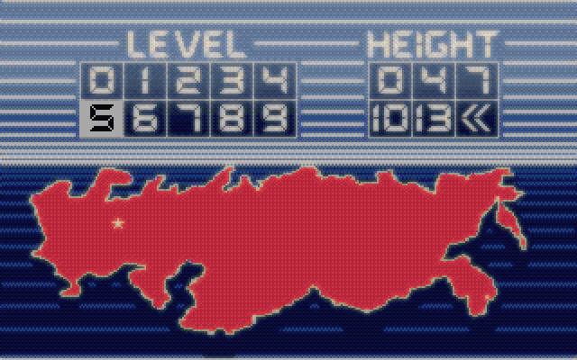
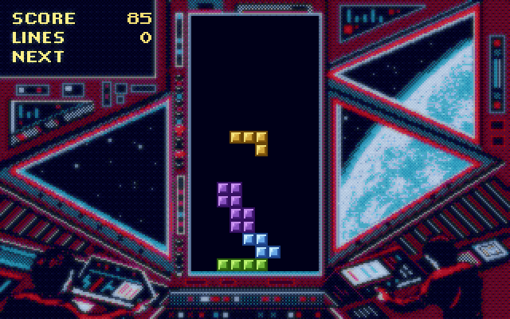
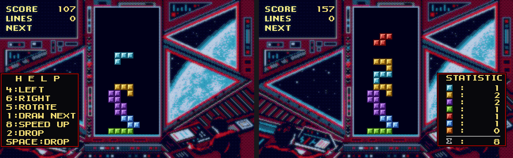
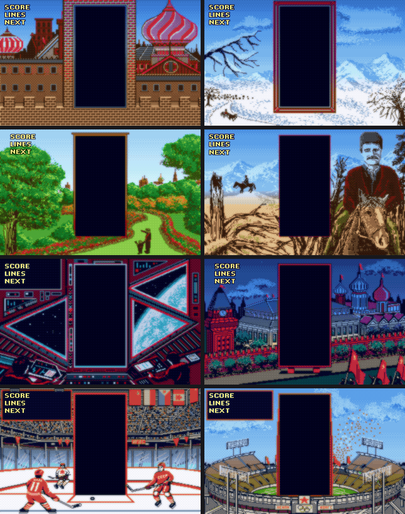

# TETRIS (Spectrum HoloByte, 1988) — 역어셈블 → C → VGA 256색

원판 `CTETRIS.EXE`(IBM CGA 판, MS EXEPACK 으로 눌려 있는 8086 어셈블리)를 풀어
기계적으로 C 로 옮기고, 같은 게임 코드에 256색 그림을 입힌 개선판을 더한 것이다.

| 만든 것 | 무엇 |
|---|---|
| `TETRIS.EXE` | 원판을 그대로 옮긴 것. CGA 모드 5 화면(검정/청록/빨강/흰색)을 VGA 13h 로 보인다 |
| `TETVGA.EXE` | 같은 게임 코드 + 256색 그림 (`TTVGA.DAT`) + 애드립 배경음악 (`SOUND.DAT`) |



*왼쪽이 원판 그대로(CGA 네 색), 오른쪽이 256색 개선판 — 같은 게임 코드가 그린 같은 화면이다.*

두 판 모두 `CWSDPMI.EXE` 와 원판 자료 파일(`BKGR0`..`BKGR9`, `SLC`, `TETRIS.TTL`)이
같은 폴더에 있어야 한다.  바로 쓸 수 있게 묶은 것은 `release/` 에 있다.

```
release\TETVGA.EXE     256색 개선판
release\TETRIS.EXE     원판 그대로
```

### 화면

| | |
|---|---|
|  |  |
|  |  |

판이 오를 때마다 배경과 음악이 그 판의 것으로 바뀐다.



## 원판 뜯어보기

* `CTETRIS.EXE` = MS EXEPACK. `tools/unexepack.py` 로 풀면 `CT_UNP.EXE`
  (자료 세그먼트 `000D`, 코드 세그먼트 `0815`, 코드 9 KB, 손으로 짠 어셈블리).
* `tools/scan.py` 가 진입점 `0014` 에서 흐름을 따라가 함수 80 개, 코드 8425 바이트를 찾는다.
  (나머지 760 바이트는 어디서도 부르지 않는 죽은 코드 — CGA/Tandy/EGA 판이 소스를 함께 쓴 흔적)
* 자판 처리는 `15DA` 의 분기표(`DS:5C8D`, 키 23 개)로 갈린다.
* 그림은 `DS:01F2` 의 그림판(320x200 CGA, 한 줄 80 바이트)에 그린 뒤
  `1385` 에서 `B800` 으로 통째로 옮긴다.  조각 칸은 8x8 (`DS:003F` 부터 16 바이트씩 여덟 개).

## 옮긴 C

* `tools/asm2c.py` → `ttcode.c` (함수마다 C 함수 하나, 레지스터는 전역, 메모리는 1 MB 평면 `M[]`).
  플래그는 쓰이는 것만 계산하고, 부르는 곳에서 넘어오는 플래그(`adc` 앞의 캐리)도 따라간다.
* `ttdata.c` = 원판 적재 이미지 (`tools/mkdata.py`), `cpu.h/cpu.c` = 8086 상태와 메모리.
* `sys_dos.c` = 도스 플랫폼(djgpp): `int 10h/16h/1Ah/21h`, 포트, 파일, 화면 내보내기.
* 기계 속도: 원판은 `0040:006C` 를 두 번 읽어 속도를 재고 그만큼 기다린다.  옮긴 C 는
  8088 클럭을 세어(`CYC()`, 문자열 명령은 길이만큼) 4.77 MHz IBM PC 와 같은 빠르기로 맞춘다
  (`TTFAST=1` 이면 맞추지 않는다).  조각은 여섯 번째 프레임마다 한 줄 내려간다.

### 원본과 대조

`tools/emu.py`(unicorn 으로 원판을 그대로 돌린다) 와 `hosttest.exe`(옮긴 C)를 같은 키로 돌려
인터럽트마다 레지스터를, 키를 읽을 때마다 메모리·화면 CRC 를 맞춰 본다.

```
sh build_host.sh              # hosttest.exe, hostvga.exe
sh tools/regress.sh           # test/k_*.txt 를 자판/조이스틱 두 갈래로
python tools/difftest.py n "50:enter 300:enter 300:enter 40:left 30:space"
python tools/ftrace.py 20000 "..."   # 첫 차이를 함수 단위로 찾기
```

`test/k_*.txt` 다섯 가지(마구잡이 키 포함)가 모두 한 줄도 다르지 않게 맞는다.

## 256색 개선판

게임 코드는 손대지 않는다.  대신 메모리 바이트마다 색표 `COL[]` 을 두고 **그림의 출처**에
256색을 미리 적어 둔다.  게임이 그 바이트를 옮기면(`movs`, `lods`/`stos`) 색표도 따라간다.

* 배경 열두 장: `tools/vgaart.py` 가 CGA 네 색 그림의 점 뿌리기(디더)를 풀어 고른 밝기를 얻고,
  그림마다 정한 규칙(하늘은 파랑 그러데이션, 벽돌은 붉은 흙빛 …)으로 다시 칠한다.
  팔레트는 `tools/pal.py` (CGA 16색 + 색줄 20 가지 x 12 단계).
* 조각 칸 일곱 가지: `tools/tiles.py` 가 보석처럼(테두리·빛·그늘·반짝이) 그린다.
* 글자: `1E3C` 는 AND/OR 로 그려 색표가 따라오지 않으므로, 그린 바로 뒤에 켠 점만 금빛으로.
* 점수판: 배경은 그대로 두고 원판 글씨(SCORE/LINES/NEXT)만 금빛으로, 한 점 두께 그림자를 둘러
  어느 배경에서나 읽히게 했다.  게임이 찍는 숫자는 바탕 밝기를 보고 금빛/짙은 색을 고른다.
* 점 뿌리기(디더)는 둘레 여덟 점 가운데 같은 색이 몇인지로 가려 낸다: 점무늬면 고르게 풀고
  면과 면의 경계는 또렷하게 둔다.  색줄이 12 단계뿐이라 생기는 그러데이션 띠는 순서 디더로 없앤다.
* 하늘과 나뭇잎처럼 CGA 색이 같은 것은 '둘레의 검은 점 밀도'(`dmix`)로 갈라 칠한다.
* 묶음 파일 만들기: `python tools/mkvga.py` → `TTVGA.DAT`

```
python tools/mkvga.py                                  # 그림 묶음
python tools/shotvga.py "50:enter 300:enter ..." out.png   # PC 에서 미리보기
python tools/dosshot.py tools/t_game.txt out.png tetvga.exe   # DOSBox 에서 찍기
```

## 소리

* **효과음**: 원판 그대로 PC 스피커다 (포트 61h 을 직접 흔든다).  옮긴 C 도 `delay_loop` 이
  8088 17 클럭만큼 진짜로 기다려 높이가 같다 — 도스박스에서 재 보니 첫 반주기가 원판 셈
  356 µs 에 실측 363 µs (스피커 토글 기록 `SPK.TXT`).
* **배경음악** (개선판만): 1988 년 판에는 없다.  같은 회사가 1992 년에 낸
  **Tetris Classic** (Spectrum HoloByte, 음악 Paul Mogg) 의 OPL3(YMF262) 음악을
  화면별로 얹었다.  원본(`vgm/`)이 이미 OPL3 스트림이라 고치지 않고 그대로 담고,
  `ttmusic.c` 가 VGM 의 `0x5E`/`0x5F` (뱅크 0/1) 를 애드립 포트 388/389, 38A/38B 로
  그대로 내보낸다.  `tools/mkmusic.py` 가 열여섯 곡을 `SOUND.DAT` 으로 묶는다.

  | 곡 | 언제 |
  |---|---|
  | TITLE | 제목·차례표·판 고르기 |
  | LEVEL1..LEVEL10 | 놀이 중 - 판이 오를 때마다 그 판의 곡으로 (배경 그림처럼) |
  | GAMEOVER | 끝났을 때 한 번 |
  | SPLASH, ADVANCE, TOP10, HIGHSC | 묶음에 함께 담아 둔 것 |

  긴 곡은 끝나면 처음부터 다시 돈다.  곡을 바꿀 때는 두 뱅크를 말끔히 비워
  앞 곡의 4-op/NEW 설정이 남지 않게 한다.  게임에서 **S** 로 소리를 끄면 음악도 멈추고,
  애드립이 없으면 조용히 넘어간다.
  귀로 확인할 때는 `tools/vgmwav.c` (Nuked OPL3) 로 WAV 를 뽑는다:
  `tools/vgmwav.exe tools/TITLE.VGM 들어보기.wav 40`
  (아타리판 POKEY 음악을 OPL2 로 옮기던 길은 `tools/vgm2opl.py` 에 남아 있다)

## 빌드

```
build.bat            TETRIS.EXE
build.bat vga        TETVGA.EXE
sh build_host.sh     PC 대조 시험판
python tools/mkvga.py    TTVGA.DAT (256색 그림)
python tools/mkmusic.py  SOUND.DAT (배경음악, vgz/ 의 아타리 POKEY 음악을 OPL2 로)
```
